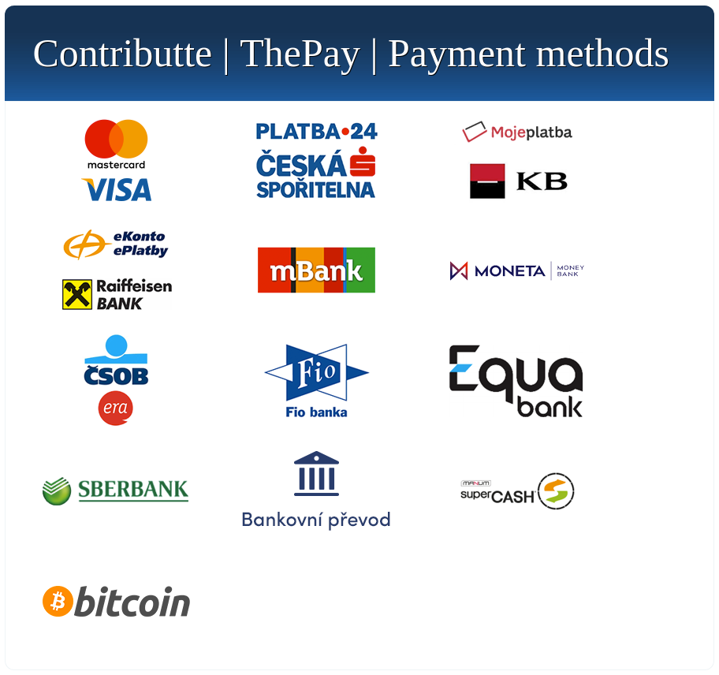

# Contributte Payments Skeleton

A Nette web-project skeleton that demonstrates listing ThePay payment methods and initiating a payment through `contributte/thepay`.

[](https://github.com/contributte/payments-skeleton/actions)
[](https://packagist.org/packages/contributte/payments-skeleton)
[](https://github.com/contributte/payments-skeleton)



## Clean-Checkout Limitation

The clean checkout enables the ThePay Nette extension but provides neither ThePay credentials nor a public local configuration template. `config/local.neon` is loaded when present, but no ignore rule protects it and no template defines a safe local credential path. Therefore, a safe, complete payment-gateway setup cannot be documented from repository evidence without directing credentials into a tracked file. Do not use production credentials with this skeleton.

## Quick Start

Requirements:

- PHP 8.4 or later with the `bcmath` and `soap` extensions
- Composer
- `make`

Create a new project with Composer, then create the writable runtime directories:

```sh
composer create-project -s dev contributte/payments-skeleton acme
cd acme
make setup
```

`make setup` creates `var/tmp` and `var/log` and grants them write permissions. It does not install dependencies or configure ThePay; `composer create-project` performs dependency installation.

After supplying a safe, untracked local ThePay configuration through a mechanism established for your deployment, run the development server:

```sh
make dev
```

Open <http://localhost:8000>. The homepage is expected to show **Contributte | ThePay** and a **List payment methods** link. Following that link calls ThePay to retrieve payment methods, so it requires valid gateway configuration and may send requests to ThePay.

The `pay` action uses demo cart ID `10`, user ID `1`, amount `1000.00 CZK`, and redirects the browser to the selected payment method. It is demonstration code, not a production checkout implementation.

## Quality Checks

```sh
make qa
```

This runs coding-standard checks and PHPStan analysis for `app`.

## Links

- [Demo](https://examples.contributte.org/payments-skeleton/)
- [ThePay package documentation](https://contributte.org/packages/contributte/thepay.html)
- [Contributte](https://contributte.org/)
- [Support Contributte](https://contributte.org/partners.html)

## Contributing

This project is maintained by the [Contributte organization](https://github.com/contributte). Report issues or contribute changes through the [GitHub repository](https://github.com/contributte/payments-skeleton) and its [issue tracker](https://github.com/contributte/payments-skeleton/issues). See the [Contributte contribution guide](https://contributte.org/contributing.html).

## License

[MIT](LICENSE), Copyright (c) 2021 Contributte.
